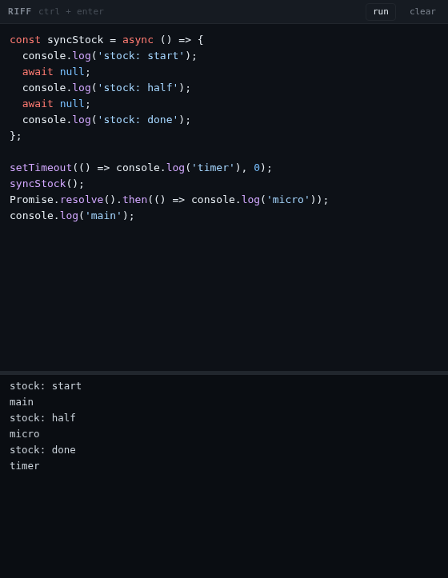

# <p align="center">Riff</p>

<p align="center">
  <strong>A pocket-sized JavaScript console.</strong>
</p>

<p align="center">
  
</p>

<p align="center">
  <strong> English</strong> | <a href="README.ru.md"> Russian</a>
</p>

<p align="center">
  
  
  
</p>

## Table of Contents

- [What It Is](#what-it-is)
- [Why Another Playground?](#why-another-playground)
- [Who It's For](#who-its-for)
- [See It Work](#see-it-work)
- [Features](#features)
- [How It Compares](#how-it-compares)
- [Getting Started](#getting-started)
  - [Prerequisites](#prerequisites)
  - [Installation](#installation)
  - [Quick Start](#quick-start)
- [Usage](#usage)
  - [Keyboard Shortcuts](#keyboard-shortcuts)
- [How It Works](#how-it-works)
- [Limitations and Non-Goals](#limitations-and-non-goals)
- [Roadmap](#roadmap)
- [Configuration](#configuration)
- [Development](#development)
- [License](#license)

## What It Is

Riff is a minimalist desktop app built on Chromium: an editor on top, a console below. You write a snippet, press `Ctrl+Enter`, and read exactly what the browser prints. One HTML file. No build step, dependencies, accounts or network.

It was built for one recurring situation: you need to know in which order JavaScript code actually runs. Not compile it, not ship it — just see it. Every run starts a fresh event loop, so timers from the previous attempt never leak into the next answer, and the console never keeps old output.

## Why Another Playground?

- **The browser console** has to be cleared by hand, keeps yesterday's output, and lives in a window built for browsing.
- **Online playgrounds** give you an HTML pane, a CSS pane, a preview and a library picker when all you need is two boxes.
- **An IDE** means an open folder, a run configuration, a terminal split the right way — for twelve lines of code.
- **Riff is the two boxes.** Run, look, change one line, run again. That loop is the whole product.

## Who It's For

- People preparing for a JavaScript interview who want to verify a hunch in ten seconds.
- Mentors and teachers who need to show the output order on a shared screen.
- Anyone who wants a second, disposable buffer next to their real work.

## See It Work

```javascript
const syncStock = async () => {
  console.log('stock: start');
  await null;
  console.log('stock: half');
  await null;
  console.log('stock: done');
};

setTimeout(() => console.log('timer'), 0);
syncStock();
Promise.resolve().then(() => console.log('micro'));
console.log('main');
```

```text
stock: start
main
stock: half
micro
stock: done
timer
```

Change one line, press `Ctrl+Enter`, get a different order. No clearing, no scrolling, no stale output.

## Features

- **A clean event loop on every run** — each run gets a new realm, so intervals and pending timers from the previous attempt are gone.
- **Real browser semantics** — microtasks, timers, `queueMicrotask`, top-level `await` and DOM APIs behave as they do in a page.
- **A console you can read** — multiple arguments, objects, arrays, `Map`, `Set`, dates, functions and errors; warnings and errors are highlighted.
- **Errors point at your line** — stack frames are rewritten to `your-code:line:column`, matching the editor.
- **Fits in a narrow window** — usable from ~340 px wide, 560×860 by default, so it sits next to a textbook.
- **Its own app window** — no tabs, no address bar; the desktop shows it as `Riff` with its own icon.
- **Nothing to install or build** — one static file that works offline.
- **Remembers the buffer** — the last snippet and the pane split survive restarts.

## How It Compares

|  | DevTools console | CodePen | Quokka | RunJS | Riff |
|---|---|---|---|---|---|
| Output cleared on every run | manual | page reload | live values | yes | yes |
| Narrow pane beside a textbook | no | no | inside the IDE | no | yes |
| Setup | none | none | extension | download | one file |
| Separate app window | no | no | no | yes | yes |
| Browser engine | yes | yes | Node by default | yes | yes |

Riff is not trying to win on features. It wins on the distance between "I wonder" and "I see it".

## Getting Started

### Prerequisites

- A Chromium-based browser. Tested in Brave; Chrome, Chromium and Edge should behave the same way.
- Bash, for the launcher script.
- No Node.js, package manager or build tools are required.

### Installation

```bash
git clone <repository-url> riff
cd riff
chmod +x run.sh
cp riff.desktop ~/.local/share/applications/
update-desktop-database ~/.local/share/applications 2>/dev/null || true
```

The app now appears in the desktop's application menu as `Riff`.

### Quick Start

```bash
./run.sh
```

This opens a 560×860 window without tabs or an address bar. The window identifies itself to the desktop as the application `riff`, so GNOME shows it under its own name and icon instead of grouping it with the browser. `--ozone-platform=x11` is deliberate: under Wayland, Chromium generates an app id of its own, which cannot be matched to the `.desktop` entry.

A plain browser tab works too:

```bash
xdg-open index.html
```

The launcher keeps its browser profile in `~/.local/share/riff/profile`, separate from your everyday browsing profile, so Riff owns its `localStorage` and runs as its own process.

## Usage

1. Paste a drill into the editor.
2. Press `Ctrl+Enter` (`Cmd+Enter` on macOS).
3. Read the console.

Change a line, press `Ctrl+Enter` again. The console is replaced on every run, so the output always belongs to the code that is on screen right now.

### Keyboard Shortcuts

| Shortcut | Action |
|---|---|
| `Ctrl`/`Cmd` + `Enter` | Run the buffer |
| `Ctrl`/`Cmd` + `/` | Toggle `//` on the current line or selection |
| `Tab` | Indent by two spaces (or indent each selected line) |
| `Shift` + `Tab` | Outdent |
| `Enter` | Auto-indent; between `{}`, `[]` or `()` it opens a block and puts the caret inside |
| Drag the bar between panes | Resize editor and console |

## How It Works

1. `run()` clears the console and increases a run token.
2. A new `srcdoc` document is written into a `sandbox="allow-scripts"` iframe. Navigation destroys the previous document together with its timers and pending tasks.
3. The runner is a function in `index.html`; it is serialized with `toString()` and executed inside the iframe, so the whole bootstrap stays in one file.
4. The runner patches `console.*`, forwards each entry to the parent over `postMessage`, and reports `error` / `unhandledrejection` events.
5. User code is evaluated inside a one-line async wrapper — `(async () => { … })()` — which enables top-level `await` while keeping the engine's line numbers one line away from the editor's.
6. Stack frames are cleaned: wrapper and bootstrap frames are dropped, the remaining offset is subtracted, and the result is printed as `your-code:line:column`.
7. Values are formatted inside the sandbox, where the objects live, and rendered in the parent as plain text.

## Limitations and Non-Goals

- **Not an IDE.** No file tree, no tabs, no git integration, no extensions.
- **No `import` and no npm.** The snippet is evaluated, not loaded as a module.
- **One buffer.** Riff is a scratchpad for the current question, not a snippet manager.
- **Sandboxed by design.** The code cannot reach the parent page, the clipboard or the filesystem.
- **Chromium-family browsers.** Firefox and Safari are untested.
- **The iframe is a visible 1×1 element on purpose** — fully hidden frames can have their timers throttled by the browser.

## Roadmap

- Auto-run on typing pause.
- Snippet history with arrow keys.
- A small library of preset drills.
- Adjustable font size and a light theme.
- Export the current buffer to a `.js` file.

## Configuration

There is no configuration file. Two keys are kept in `localStorage`:

| Key | Contents |
|---|---|
| `riff.code` | Last buffer |
| `riff.split` | Editor height in pixels |

When launched through `run.sh`, `localStorage` lives in `~/.local/share/riff/profile`. Delete that directory to reset the app state. Keys from the pre-rename version (`jsdrill.*`) are migrated automatically on first load.

## Development

Edit `index.html` and reload the window; there is no build step.

A manual smoke test before committing:

1. Run the event-loop snippet above and compare the output with the expected order.
2. Start `setInterval` in one run, then run `console.log('fresh')` — only `fresh` must appear.
3. Throw inside `setTimeout` and check that the reported line matches the editor.
4. Reload the window and confirm the buffer is still there.

## License

This project is licensed under the [MIT License](LICENSE).

---

<p align="center">
  Built with ❤ by <a href="https://t.me/nightrunner91">nightrunner91</a>
</p>
