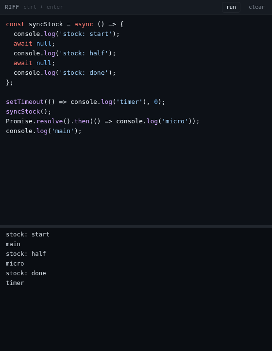

# <p align="center">Riff</p>

<p align="center">
  <strong>Карманная консоль для JavaScript.</strong>
</p>

<p align="center">
  
</p>

<p align="center">
  <a href="README.md"> English</a> | <strong> Русский</strong>
</p>

<p align="center">
  
  
  
</p>

## Содержание

- [Что это](#что-это)
- [Зачем ещё одна песочница?](#зачем-ещё-одна-песочница)
- [Кому пригодится](#кому-пригодится)
- [Как это выглядит в работе](#как-это-выглядит-в-работе)
- [Возможности](#возможности)
- [Сравнение](#сравнение)
- [Начало работы](#начало-работы)
  - [Требования](#требования)
  - [Установка](#установка)
  - [Быстрый старт](#быстрый-старт)
- [Использование](#использование)
  - [Горячие клавиши](#горячие-клавиши)
- [Как это работает](#как-это-работает)
- [Ограничения и не-цели](#ограничения-и-не-цели)
- [Планы](#планы)
- [Конфигурация](#конфигурация)
- [Разработка](#разработка)
- [Лицензия](#лицензия)

## Что это

Riff — минималистичное desktop приложение на базе Chromium: сверху редактор кода, снизу консоль. Пишешь сниппет, жмёшь `Ctrl+Enter` и читаешь ровно то, что печатает браузер. Один HTML-файл. Без сборки, зависимостей, аккаунтов и сети.

Инструмент вырос из одной повторяющейся ситуации: нужно понять, в каком порядке на самом деле выполняется код JavaScript. Не собрать, не задеплоить — просто увидеть. Каждый запуск начинается с чистого event loop: таймеры из прошлой попытки не попадают в следующий ответ, а в консоли не остаётся старого вывода.

## Зачем ещё одна песочница?

- **Консоль браузера** приходится чистить руками, в ней висит вчерашний вывод, и живёт она в окне, рассчитанном на сёрфинг.
- **Онлайн-песочницы** предлагают панель HTML, панель CSS, превью и выбор библиотек, когда нужны всего две коробки.
- **IDE** — это открытая папка, конфигурация запуска и правильно разбитый терминал ради двенадцати строк кода.
- **Riff — это те самые две коробки.** Запустил, посмотрел, поменял строку, запустил снова. На этом цикле держится всё.

## Кому пригодится

- Тем, кто готовится к собеседованию по JavaScript и хочет быстро проверить догадку.
- Менторам и преподавателям, которым нужно показать порядок вывода на общем экране.
- Всем, кому нужен второй, черновой буфер рядом с основной работой.

## Как это выглядит в работе

```javascript
const syncStock = async () => {
  console.log('stock: start');
  await null;
  console.log('stock: half');
  await null;
  console.log('stock: done');
};

setTimeout(() => console.log('timer'), 0);
syncStock();
Promise.resolve().then(() => console.log('micro'));
console.log('main');
```

```text
stock: start
main
stock: half
micro
stock: done
timer
```

Меняешь строку, жмёшь `Ctrl+Enter` — получаешь другой порядок. Без очистки, без прокрутки, без устаревшего вывода.

## Возможности

- **Чистый event loop на каждый запуск** — новое окружение на каждый запуск, поэтому интервалы и отложенные таймеры прошлой попытки исчезают.
- **Настоящая семантика браузера** — микрозадачи, таймеры, `queueMicrotask`, top-level `await` и DOM API ведут себя как на обычной странице.
- **Консоль, которую можно читать** — несколько аргументов, объекты, массивы, `Map`, `Set`, даты, функции и ошибки; предупреждения и ошибки подсвечены.
- **Ошибки указывают на твою строку** — кадры стека переписаны в `your-code:строка:колонка`, как в редакторе.
- **Помещается в узкое окно** — рабочий минимум ~340 px, по умолчанию 560×860, так что его можно поставить рядом с учебником.
- **Своё окно приложения** — без вкладок и адресной строки; в системе оно видно как `Riff` со своей иконкой.
- **Нечего устанавливать и собирать** — один статический файл, работает офлайн.
- **Помнит буфер** — последний сниппет и положение разделителя переживают перезапуск.

## Сравнение

|  | Консоль DevTools | CodePen | Quokka | RunJS | Riff |
|---|---|---|---|---|---|
| Вывод очищается на каждом запуске | вручную | перезагрузка страницы | значения обновляются на месте | да | да |
| Узкая панель рядом с учебником | нет | нет | внутри IDE | нет | да |
| Подготовка | никакой | никакой | расширение | установка | один файл |
| Отдельное окно приложения | нет | нет | нет | да | да |
| Движок браузера | да | да | по умолчанию Node | да | да |

Riff не пытается выиграть по возможностям. Он выигрывает на расстоянии между «интересно, как» и «вот как».

## Начало работы

### Требования

- Браузер на Chromium. Проверено в Brave; Chrome, Chromium и Edge должны вести себя так же.
- Bash — для скрипта запуска.
- Node.js, пакетный менеджер и инструменты сборки не нужны.

### Установка

```bash
git clone <repository-url> riff
cd riff
chmod +x run.sh
cp riff.desktop ~/.local/share/applications/
update-desktop-database ~/.local/share/applications 2>/dev/null || true
```

После этого `Riff` появляется в меню приложений.

### Быстрый старт

```bash
./run.sh
```

Открывается окно 560×860 без вкладок и адресной строки. Для окружения окно представляется приложением `riff`, поэтому GNOME показывает его под своим именем и со своей иконкой, а не группирует с браузером. Флаг `--ozone-platform=x11` стоит намеренно: под Wayland Chromium генерирует app id сам, и сопоставить его с `.desktop`-файлом нельзя.

Обычная вкладка браузера тоже работает:

```bash
xdg-open index.html
```

`run.sh` держит профиль браузера в `~/.local/share/riff/profile` отдельно от основного профиля, поэтому у Riff свой `localStorage` и свой процесс.

## Использование

1. Вставь задачу в редактор.
2. Нажми `Ctrl+Enter` (`Cmd+Enter` на macOS).
3. Читай консоль.

Меняешь строку — жмёшь `Ctrl+Enter` снова. Консоль заменяется на каждом запуске, поэтому вывод всегда относится к тому коду, который сейчас на экране.

### Горячие клавиши

| Комбинация | Действие |
|---|---|
| `Ctrl`/`Cmd` + `Enter` | Запустить буфер |
| `Ctrl`/`Cmd` + `/` | Поставить или снять `//` на текущей строке или выделении |
| `Tab` | Отступ в два пробела (или отступ каждой выделенной строки) |
| `Shift` + `Tab` | Убрать отступ |
| `Enter` | Автоотступ; между `{}`, `[]` или `()` открывает блок и ставит курсор внутрь |
| Перетаскивание полосы между панелями | Изменить размер редактора и консоли |

## Как это работает

1. `run()` очищает консоль и увеличивает токен запуска.
2. В `iframe` с атрибутом `sandbox="allow-scripts"` записывается новый `srcdoc`. Навигация уничтожает предыдущий документ вместе с его таймерами и отложенными задачами.
3. Раннер — это функция внутри `index.html`; она сериализуется через `toString()` и выполняется внутри `iframe`, поэтому весь бутстрап остаётся в одном файле.
4. Раннер подменяет `console.*`, пересылает каждую запись в родительское окно через `postMessage` и сообщает о событиях `error` / `unhandledrejection`.
5. Код пользователя выполняется внутри однострочной async-обёртки — `(async () => { … })()` — это включает top-level `await`, а номера строк движка остаются на одну строку впереди редактора.
6. Кадры стека очищаются: кадры обёртки и бутстрапа отбрасываются, оставшееся смещение вычитается, результат печатается как `your-code:строка:колонка`.
7. Значения форматируются внутри песочницы, там где живут объекты, и выводятся в родительском окне как обычный текст.

## Ограничения и не-цели

- **Не IDE.** Ни дерева файлов, ни вкладок, ни git, ни расширений.
- **Никаких `import` и npm.** Сниппет вычисляется, а не загружается как модуль.
- **Один буфер.** Riff — черновик под текущий вопрос, а не менеджер сниппетов.
- **Песочница по замыслу.** Код не имеет доступа к родительской странице, буферу обмена и файловой системе.
- **Браузеры на Chromium.** Firefox и Safari не проверялись.
- **`iframe` намеренно отрисован как элемент 1×1** — полностью скрытые фреймы браузер может троттлить по таймерам.

## Планы

- Автозапуск по паузе в наборе.
- История сниппетов по стрелкам.
- Небольшая библиотека готовых задач.
- Настройка размера шрифта и светлая тема.
- Экспорт текущего буфера в `.js`.

## Конфигурация

Файла настроек нет. В `localStorage` хранятся два ключа:

| Ключ | Содержимое |
|---|---|
| `riff.code` | Последний буфер |
| `riff.split` | Высота редактора в пикселях |

При запуске через `run.sh` `localStorage` живёт в `~/.local/share/riff/profile`. Удали эту папку, чтобы сбросить состояние. Ключи из версии до переименования (`jsdrill.*`) переносятся автоматически при первой загрузке.

## Разработка

Правь `index.html` и перезагружай окно; шага сборки нет.

Ручной смоук-тест перед коммитом:

1. Запусти сниппет про event loop выше и сверь порядок вывода с ожидаемым.
2. Запусти `setInterval` в одном запуске, затем выполни `console.log('fresh')` — появиться должен только `fresh`.
3. Брось исключение внутри `setTimeout` и проверь, что показанная строка совпадает с редактором.
4. Перезагрузи окно и убедись, что буфер на месте.

## Лицензия

Этот проект распространяется под лицензией [MIT](LICENSE).

---

<p align="center">
  Сделано с ❤ <a href="https://t.me/nightrunner91">nightrunner91</a>
</p>
